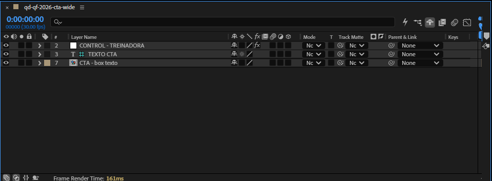
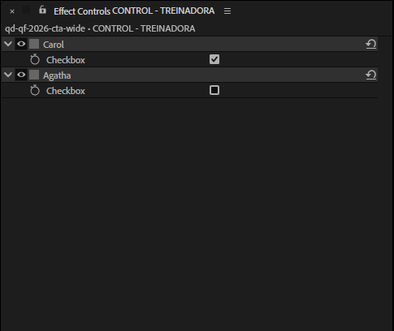
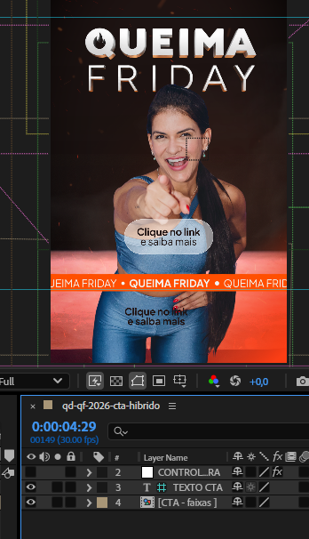
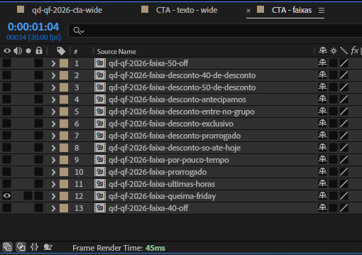

Guia do projeto

# After editável de CTA QF

Um projeto de After Effects com o CTA da campanha já animado e aprovado. Você escolhe a treinadora, escreve o texto do pop-up e ativa a faixa, sem mexer na animação.

Formatos

Wide e Híbrido

Você edita

Treinadora, texto do pop-up e faixa

Já vem pronto

Animação, cores e fontes

01

## Como funciona

Do arquivo aberto ao vídeo exportado, em cinco etapas.

1. 1

   ### Abra o projeto

   Abra o arquivo `.aep` do projeto no After Effects.
2. 2

   ### Abra a composição de CTA

   Escolha a composição do formato que vai exportar: `qd-qf-2026-cta-wide` ou `qd-qf-2026-cta-hibrido`.

   

   Composição wide, com as camadas CONTROL - TREINADORA, TEXTO CTA e CTA - box texto.
3. 3

   ### Escolha a treinadora

   No layer `CONTROL - TREINADORA`, abra a aba Effect Controls e marque o checkbox de quem entra no vídeo: Agatha ou Carol.

   

   Effect Controls: um checkbox para Carol e outro para Agatha.
4. 4

   ### Escreva o texto do pop-up

   No layer `TEXTO CTA`, insira o texto do pop-up.

   Obs.O texto aparece duas vezes no vídeo, só para você ver o que está escrevendo. Ao exportar, aparece apenas o pop-up.

   Obs.Ao dar Enter, a linha de baixo fica automaticamente mais fina.

   

   Pop-up com a segunda linha mais fina.
5. 5

   ### Ative a faixa

   Para alterar a faixa (ex.: “desconto urgente”, “tempo limitado”), entre na composição `CTA - faixas` e ative a faixa correta.

   

   Uma faixa visível por vez. Aqui, a faixa queima-friday está ativa.

02

## Tipografia

Duas famílias, ambas gratuitas no Google Fonts.

Manrope

Títulos, preços e “OFF”.

50%OFF

Plus Jakarta Sans

CTA, faixas, selos e textos de apoio.

Assinar agora

Preço garantido enquanto sua assinatura estiver ativa.

### Fontes do projeto

Disponíveis no caminho:

W:\\PRODUCAO\\Queima Diária\\Edicao\\projetos\\qd-qf-2026\\qd-qf-2026-000\\ASSETS\\7. FONTS

03

## Entrega

Nomenclatura dos arquivos exportados.

Um nome por arquivo, sempre com o texto completo do pop-up em minúsculas, separado por traços.

Híbrido

qd-qf-2026-cta-hibrido-INFORMAÇÃO DO POPUP

Wide

qd-qf-2026-cta-wide-INFORMAÇÃO DO POPUP

Exemplo com o pop-up “Clique no link e saiba mais”

qd-qf-2026-cta-wide-clique-no-link-e-saiba-mais